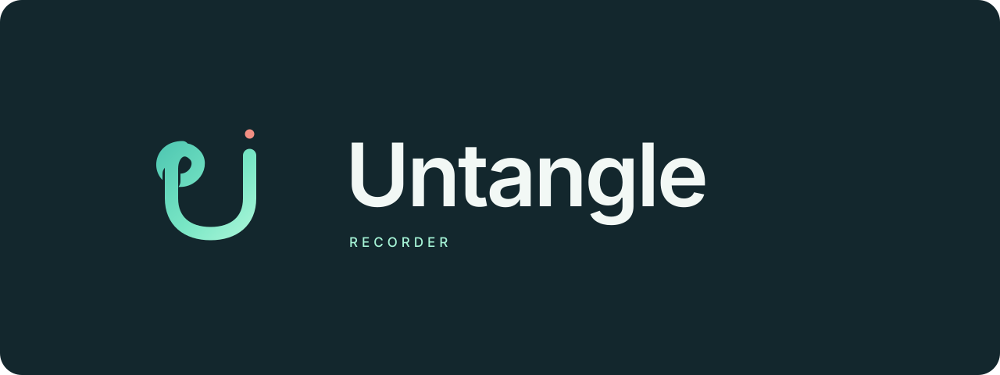

# Untangle



A clear recording beats another long message.

Untangle records your screen, your camera, or both. Review the video in the app, give it a useful name, and share it when you're ready. Your recordings stay on your computer until you choose to upload them.

This is a native Linux app built with Qt and OBS. Python handles the interface and recording controls. OBS handles capture, composition, and encoding.

## What it does

- Record a whole screen, a selected window, or the full camera image.
- Add a camera bubble, choose its shape, and zoom toward the pointer.
- See microphone levels before recording and listen to a quick audio check.
- Reduce microphone noise with RNNoise and limit loud peaks.
- Browse, play, rename, delete, and copy paths to saved recordings.
- Connect your Loom account and upload a selected video through Atlassian's official CLI.

Recording starts in MKV so an interrupted session has a better chance of recovery. After you stop, FFmpeg prepares an MP4 without re-encoding. The local file stays yours if sharing fails.

## Where it stands

Untangle currently targets x86-64 Linux, X11, and OBS 27. Wayland capture isn't supported. Output options are 4K or 1080p at 30 fps, with Intel VAAPI preferred when available.

Bluetooth audio still needs work. A OnePlus test produced silence through native PulseAudio, PipeWire, and OBS capture. We haven't established why that happened or why the reported Meet/Loom path worked. Microphone checks and visible levels help detect failures. They don't prove audio quality. See the [diagnostic evidence](docs/testing.md).

Browser-tab and region capture are outside this baseline. The separate [capture-selection PR](https://github.com/itse4elhaam/dotfiles/pull/29) remains unmerged. The visual identity is also being reconsidered.

## Set up development

You'll need Python 3.10+, `uv`, the system OBS 27 libraries and plugins, FFmpeg, `v4l2-ctl`, `pactl`, and X11. Bluetooth preparation also uses `busctl` to check the live connection.

```bash
uv venv --python /usr/bin/python3 .venv
uv pip install --python .venv/bin/python -r requirements.txt
./scripts/test.sh
```

The test command uses offscreen Qt, mocks, and synthetic media. It doesn't open your camera or microphone. T3's Untangle project has setup and headless-test commands too. Neither runs automatically.

Qt is pinned to 6.11.1. Version 6.12.0 crashed the tested Python 3.10 runtime during repeated widget updates. Keep Essentials, Addons, and Shiboken on matching versions.

## Install when you're ready

```bash
./scripts/install.sh
```

Installation changes your local launchers and desktop entry. It points `untangle` and the compatibility `recit` command at this checkout and reuses the existing private runtime. Cloning the repo or running tests doesn't perform that cutover.

After installation, open Untangle from your application launcher or run `untangle`. The recorder itself opens selected capture devices, including live microphone monitoring when enabled.

For Loom, open Sharing and choose Connect Loom account. Complete Atlassian's sign-in flow yourself. Connecting doesn't upload a recording. The optional official CLI needs to be installed separately; [the usage guide](docs/usage.md#loom) covers the setup and account limits.

## Recording controls

Choose Camera for the full camera frame, or Loom for screen and camera recording. In screen mode, choose your display or a specific window. Check the microphone, then start recording.

- `Ctrl + Shift + F9` starts recording or stops and saves.
- `Ctrl + Shift + F10` pauses or resumes.
- `Ctrl + Shift + F8` toggles pointer zoom during screen recording.
- `Escape` cancels a pending start.

Recordings opens the local library. Select a video to watch it, rename it, copy its path, delete it, or upload it to Loom.

## Find your way around

```text
src/untangle/    app, recording engine, audio helpers, and player
tests/         regression checks and synthetic fixtures
scripts/       setup helpers and headless test runner
bin/           Untangle and legacy RecIt launchers
assets/        editable logos and app icons
docs/          usage, debugging, verification, and migration notes
```

[Using Untangle](docs/usage.md) covers camera shapes, window capture, microphone selection, Loom, and recovery. [Audio troubleshooting](docs/audio-troubleshooting.md) explains the structured logs. [Verification](docs/testing.md) records what has been tested and what still needs hardware validation.

## Existing RecIt data

Untangle was called RecIt. The standalone repo preserves its app history. Your settings, recordings, logs, and Loom credentials keep their existing locations so a rename doesn't reset your setup.

Recordings remain in `~/Videos/RecIt`. Logs remain in `~/.local/state/glint/glint.log`. The private runtime stays in `~/.local/share/glint`, and the existing settings and single-instance identifiers remain compatible.

See [migration notes](docs/migration.md) before switching an existing installation. The [brand files](docs/brand.md) contain the editable logo assets.
