# PR #26 visual evidence

Historical capture pack. The manifest identifies its source; these images are not the current release. Use [UI standards](../ui-standards.md) for isolated reproduction.

Actual production Qt widgets, offscreen Fusion, captured from the updated integration branch at 960 × 760; Settings 560 × 640 and guide 720 × 640. Native capture is replaced by a painted synthetic source. Engine, audio devices, subprocesses, playback, accounts and uploads are mocked. Rendering ran inside bubblewrap with private devices, runtime and networking, with only this output folder writable. No app entry point, hardware capture, audible playback, OAuth or service activation.

The manifest records the UI/renderer source hashes and PNG hashes. These are review captures, not native OBS/output or optical quality verification. Camera ranking is tested with synthetic capabilities, not demonstrated by the single mock camera here.

| View | Light | Dark |
| --- | --- | --- |
| Default camera setup; details collapsed and redundant setup text removed | [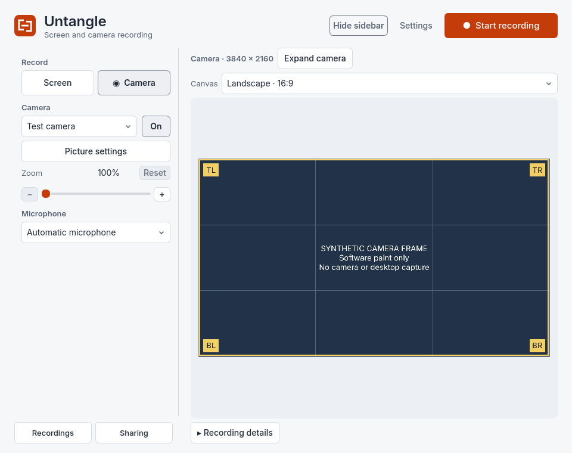](recorder-light.png) | [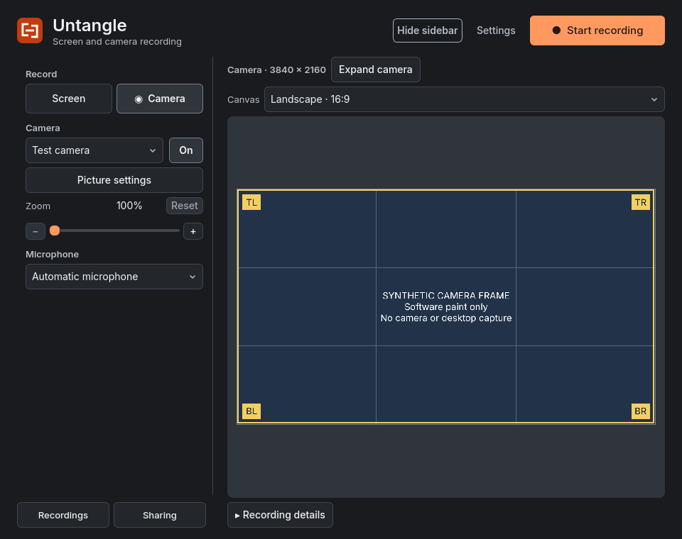](recorder-dark.png) |
| Recording details expanded | [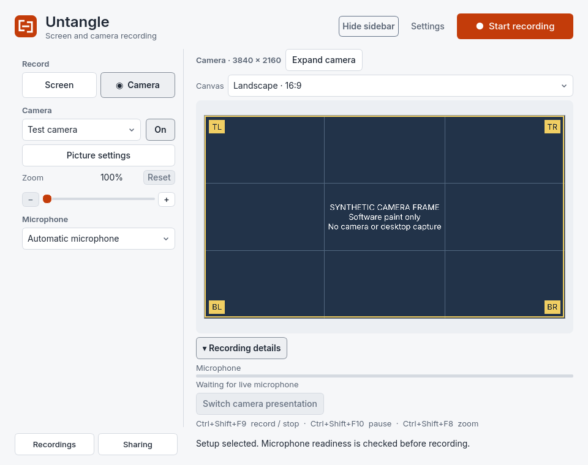](details-expanded-light.png) | [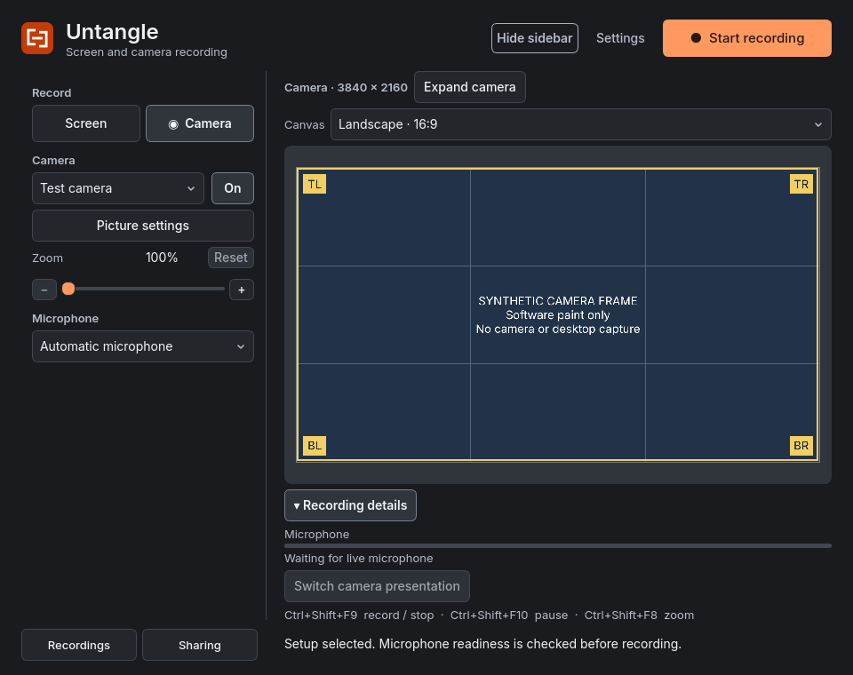](details-expanded-dark.png) |
| Screen setup retains independent 100% zoom after camera is set to 180% | [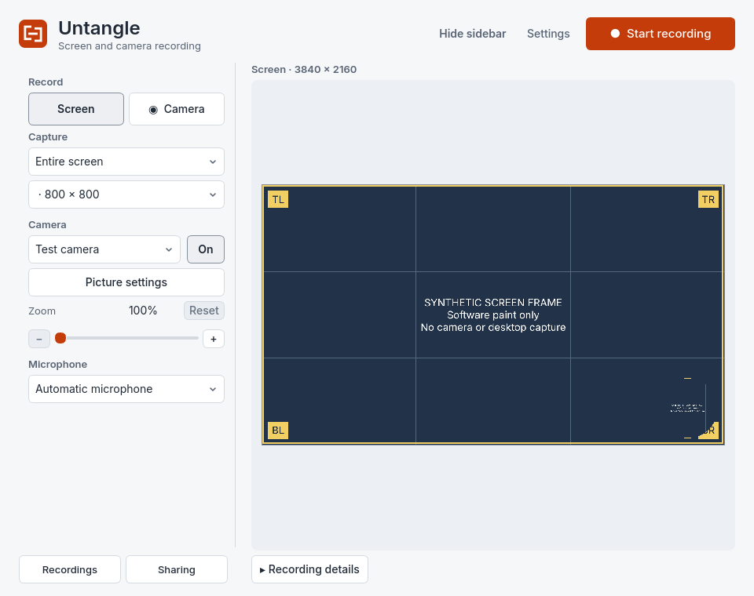](screen-light.png) | [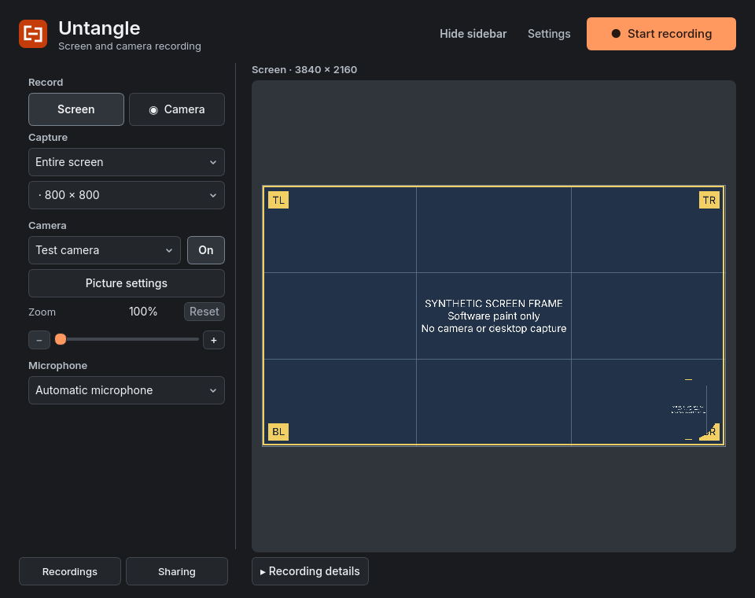](screen-dark.png) |
| Quick audio check in Settings and Drive guide entry | [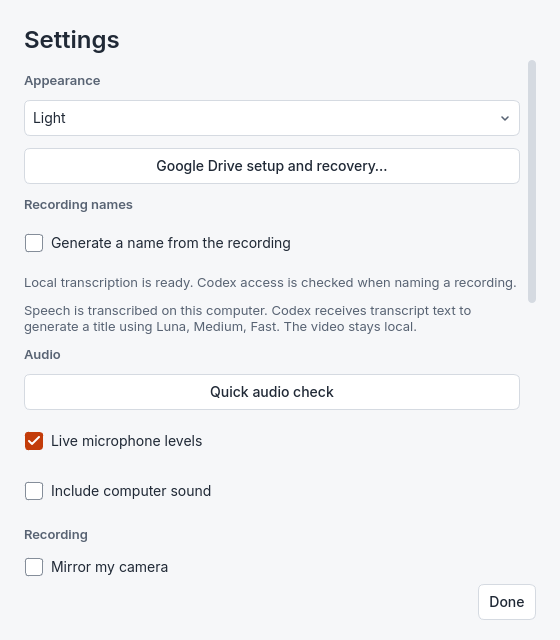](settings-audio-light.png) | [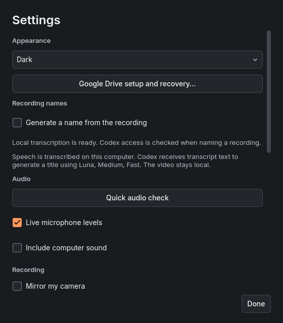](settings-audio-dark.png) |
| Camera-only crop position controls at 180% zoom; fixed schematic crop | [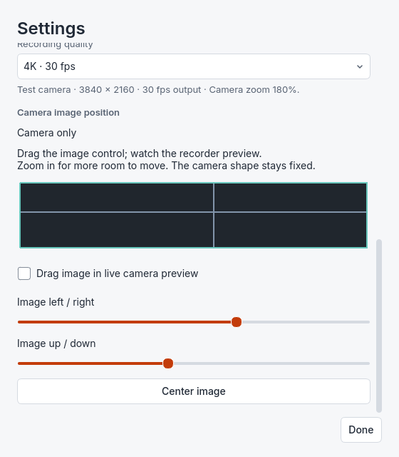](settings-crop-light.png) | [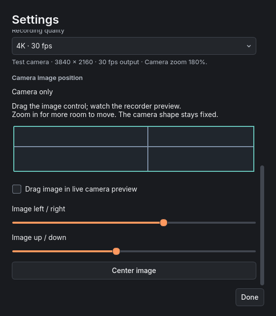](settings-crop-dark.png) |
| Per-recording rename/delete icons and current library actions | [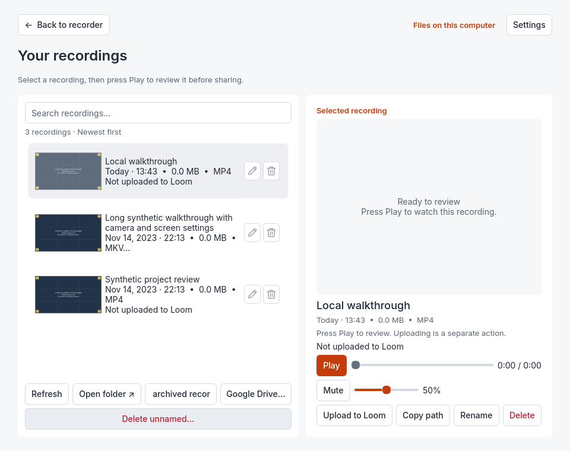](library-light.png) | [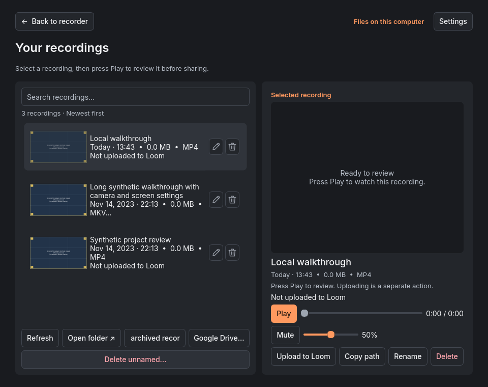](library-dark.png) |
| Local Google Drive setup and recovery guide | [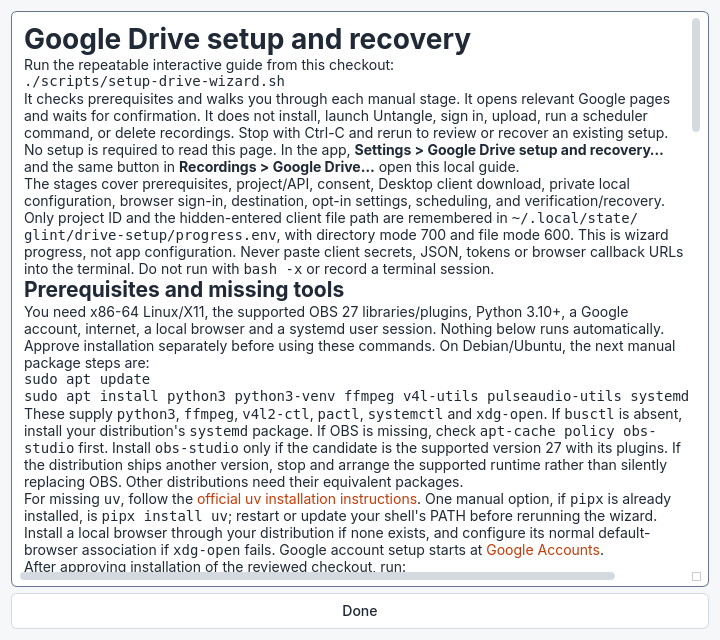](drive-guide-light.png) | [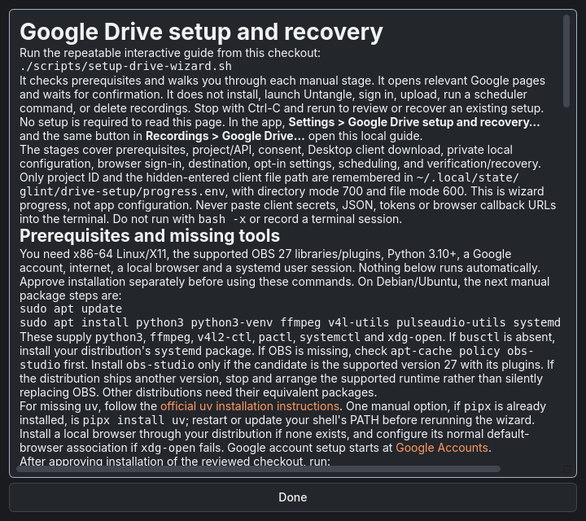](drive-guide-dark.png) |
| Recorder with setup sidebar hidden | [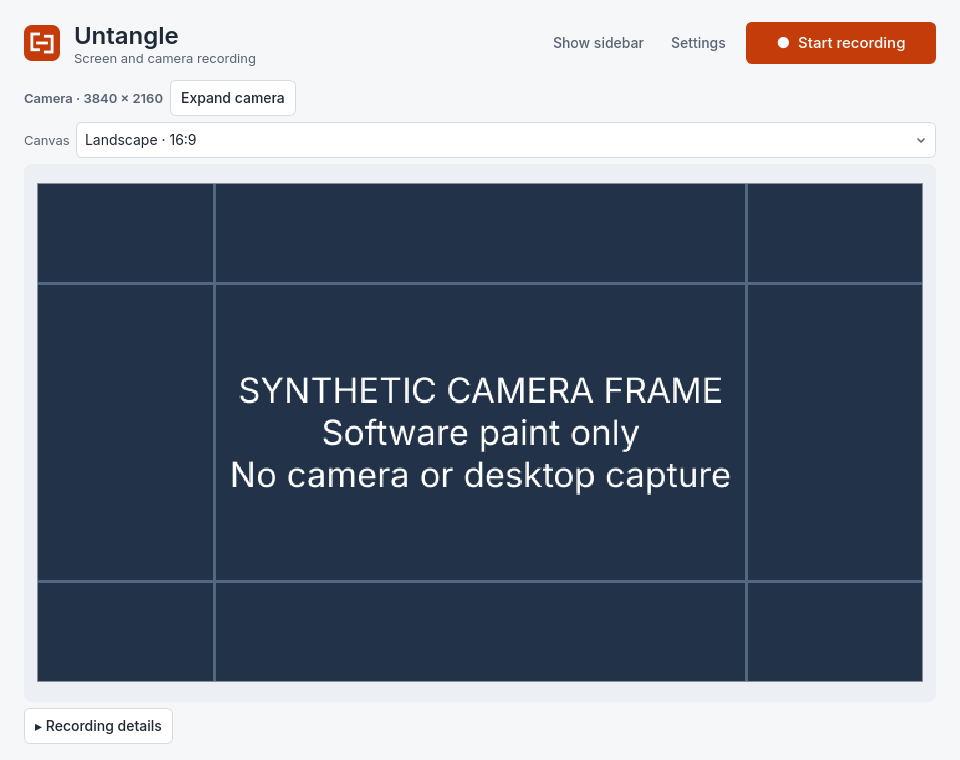](collapsed-light.png) | [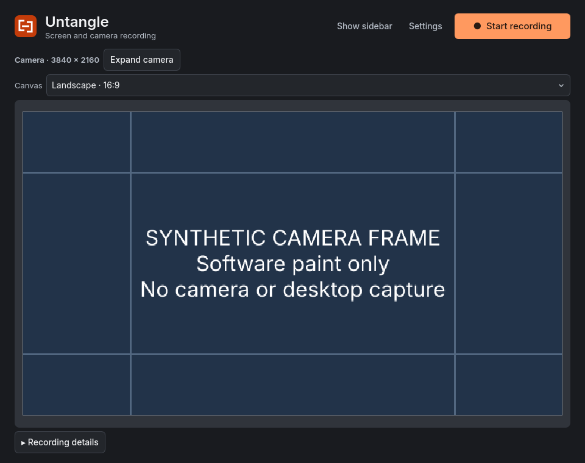](collapsed-dark.png) |

[Top of Settings](settings-dark.png) is also included in both themes.

The [earlier reference captures](../ux-review-images/README.md), newly carried by the base branch, precede the details/crop/guide changes. They are labelled historical references rather than a pixel-identical render of the current base; that capture manifest identifies its source.

Observed remaining layout issue at 960 px: the archive-review button text clips; long recording rows can elide the status line. The newly authorized UX follow-through thread owns library layout improvements. This merge update preserves runtime behavior and exposes the issue rather than hiding it. Crop-position snapshots deliberately scroll Settings to its lower section; partial preceding controls at the viewport edge are expected.
